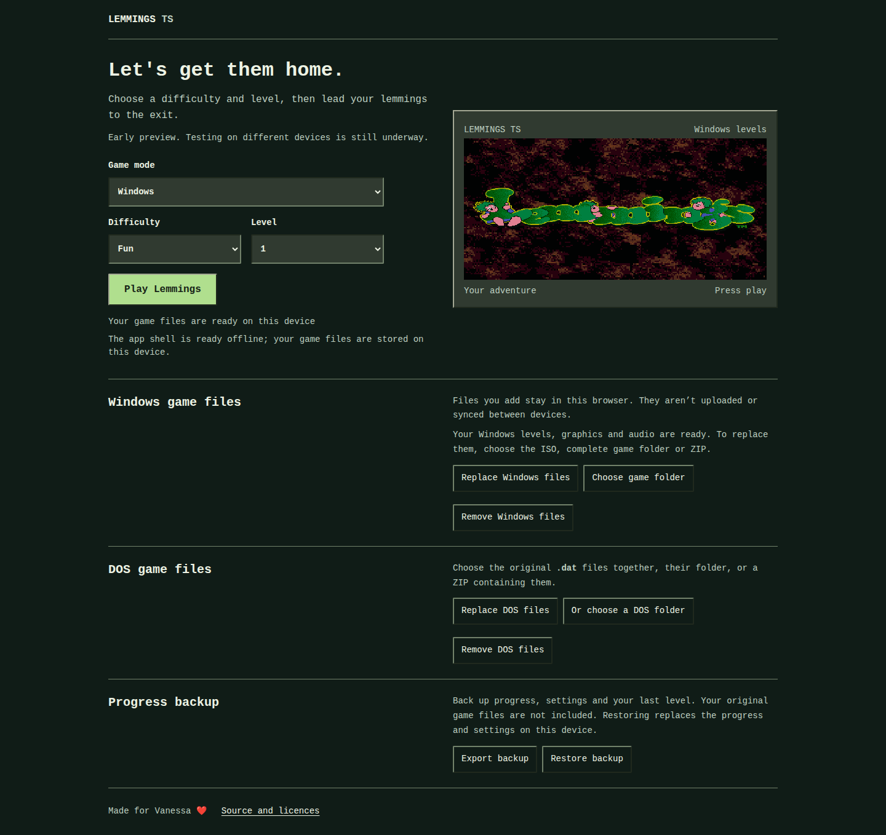
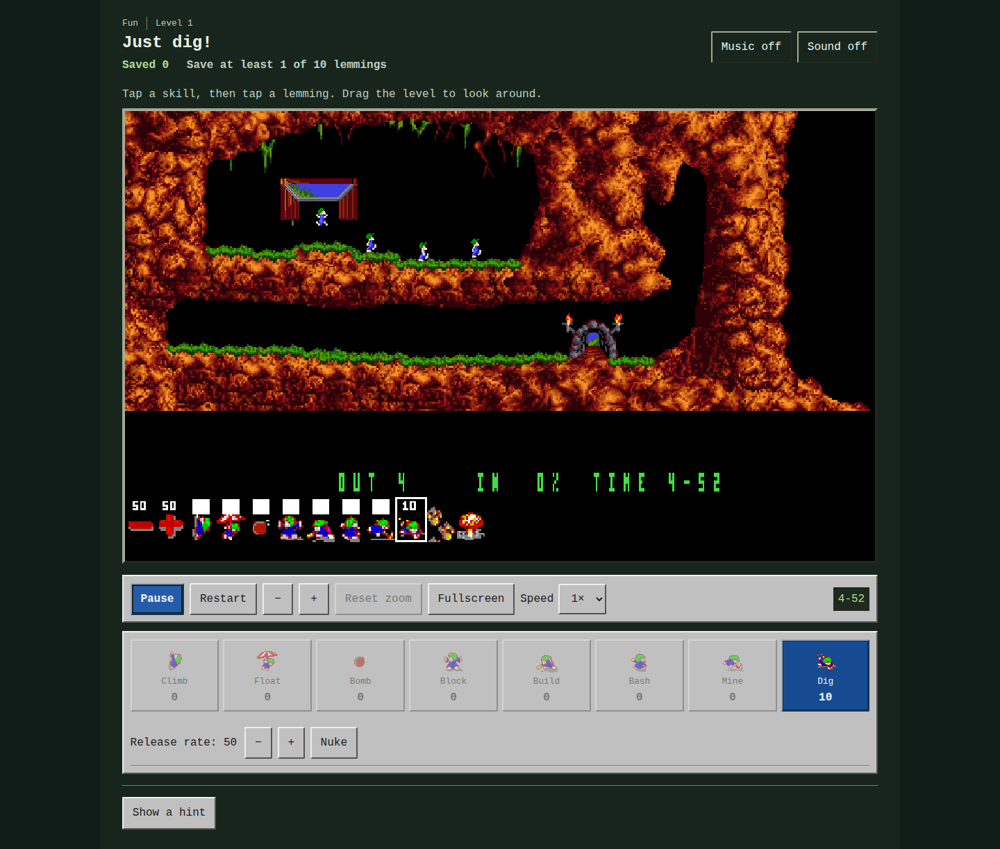

# Lemmings TS

**No Lemmings game files are included in this repository. To play, you need your own licensed copy of the Windows or DOS game.**

A modern browser player built on [Lemmings.ts](https://github.com/tomsoftware/Lemmings.ts), Thomas Zeugner's TypeScript Lemmings clone. The original project supplied the game engine, DOS data readers, rendering and AdLib music playback that this version builds on. Thanks to Thomas for making that work available.

Play with a mouse on a computer or with touch on an Android phone or tablet. The app can be installed from the browser and, once the app and your own game files are stored on the device, played offline. This is an early preview: actual Android hardware and some physics details still need further verification.

## Screenshots

The home screen with Windows mode selected:



A level in progress using the Windows artwork and controls:



These screenshots show the home screen with Windows selected and a Windows level in play. The home title artwork comes from locally supplied DOS files; the in-game artwork comes from the Windows edition. A Windows-only installation uses the home screen's CSS artwork. The repository includes the screenshots, but neither the game files needed for play nor the screenshots are included in the downloadable application source archive.

## What changed

This modernization retains the original engine and game data formats while improving the experience around them:

- Replaced the old Vue CLI toolchain with Vite and current Vue and TypeScript tooling, a lockfile, type checking, automated tests and CI.
- Redesigned level selection and gameplay screens for desktop and touch, including responsive canvas scaling, skill controls, panning, zoom, speed, an in-game pause menu and level navigation. Fullscreen uses the browser API when available and an expanded view otherwise.
- Recreated the surrounding interface with a pixel-era look. After import, the home screen decodes the original title artwork from the player's own `MAIN.DAT` in memory; before import it uses original CSS artwork. The standard build contains no original game graphics.
- Polished both screens with a shared forest-and-stone palette, consistent typography, beveled controls and clearer focus states. Desktop sizing keeps the game and its main controls together on typical laptop displays; phone layouts wrap controls into touch-sized rows.
- Added a local game-file import, including ZIP support, and an optional deployment bundle that loads automatically on each device. The app shell has an installable PWA manifest and offline cache; progress and preferences are saved locally per browser.
- Added structural validation before replacing imported game files, an offline-readiness indicator, and safer app-shell updates that retain a working offline version if an update is interrupted.
- Made level objectives and rescued counts visible, added action feedback and a shared nuke confirmation, remembered the last level and best result, and added progress-only backup and restore.
- Added keyboard lemming targeting and an optional visual first-move example, reconstructed from a separate tested replay without changing the player's current game.
- Improved game-data decoding, DOS simulation behaviour and audio handling, with focused regression tests and optional tests using locally supplied original files. Builder terrain and explosion particles are clipped at map edges and rendered opaquely, legacy click/debug artifacts are removed, and malformed audio programs are bounded so they cannot hang the game.
- Added completion replays and progressive, optional hints for all 120 original DOS levels and all 114 levels on the supplied Windows disc. Each replay has been tested against the corresponding local files; loading a level alone is not treated as proof that it can be completed.
- Added optional original AdLib music and effects, plus synthesized PC-speaker-style digging, bashing, mining and nuke cues. The synthesized sounds are approximations, not original samples.
- Added separate DOS and Windows modes. Windows mode can run directly from a compatible Windows ISO, deriving its level list, terrain, characters, objects, gameplay masks, toolbar, effects and music from the player’s files.
- Added an application source archive and licence notices to production builds. The original game files are not included.

The original Lemmings.ts project also described support for other Lemmings editions. Their historical configuration and parsers remain in the repository, but this version supports original DOS Lemmings and the supplied Windows Lemmings edition; other editions should not be assumed to work.

## Bring your own game files

The repository and standard build do not include original DOS or Windows game files; the screenshots above show artwork from a locally supplied copy. Use your own compatible copy; the expected names are listed in [the original-DOS file list](public/data/lemmings/README.md). The local `dos/` directory is ignored by Git, including `dos/lemmings/` and any ZIP kept there. Never commit original game files or put them in `public/data`: the build rejects unexpected files in that directory.

Open the app and choose **Add Windows ISO** to select your Windows ISO or an unencrypted ZIP, or choose an extracted Windows game folder. Alternatively, use the DOS controls to select the original `.dat` files together, their folder, or a ZIP. Names are accepted in upper or lower case. The app checks file structure before storing the files in the browser's local IndexedDB; it does not upload them. Failed DOS and Windows replacements leave the existing files intact, including when a storage write fails. A Windows ISO's audio, graphics and levels are validated before being saved together in one transaction. Intentional component-only Windows folder or ZIP imports replace only the components selected; an invalid selected component cancels the entire replacement. ZIPs with duplicate game filenames are rejected, including repeated entries at the same path. Structural validation cannot prove that a set is the exact edition used for the tested hints. Import separately on each device. Use **Remove DOS files** or **Remove Windows files** on the home screen to remove the corresponding edition; removing one edition preserves the other. Clearing site storage may remove all files and progress.

### Optional deployment bundle

A deployment can include your own files so that a new device loads them automatically. Put the required original DOS files in the ignored `dos/lemmings/` directory, then run:

```sh
npm ci
npm run build:local
```

This validates the required files and copies them into `dist/data/local-game/`, with a small manifest. The files have the same visibility as their deployment: anyone who can access those paths can download them. To keep a deployment private, the host must require authentication for the site **and its asset paths**. A separate public URL or leaving the files out of Git does not protect a deployed copy. The generated `dist/` directory and the original `dos/` directory are ignored by Git; the source archive excludes game files.

On first visit, the app checks for the same-origin manifest, downloads and validates the files, and stores them in that browser's IndexedDB. Existing files are never overwritten by the automatic import; if the bundle is absent or cannot be validated, manual import remains available. Removing game files deliberately prevents them being automatically re-imported on that browser; adding files manually works as usual. The service worker does not cache the bundle. Each device needs to load it while online before it can play offline.

`npm run build` is the default, game-file-free build and clears the prior `dist/` output, including any deployment bundle. An alternative source directory can be supplied to the opt-in build with `LEMMINGS_DOS_DIR=/path/to/files npm run build:local`. The host must serve the generated JSON manifest and DAT files as static files on the same origin; authentication redirects or an HTML fallback for a missing file cannot act as a bundle.

To bundle Windows audio as well, place the Windows `SOUND` and `MUSIC` folders in the ignored `dos/windows-audio/` directory before running `npm run build:local`, or set `LEMMINGS_WINDOWS_AUDIO_DIR` to a directory containing those folders. The bundle is separate from the DOS bundle and is imported without overwriting audio already saved or deliberately removed on a device. Anyone who can access the deployment can download the bundled audio. The standard build and source archive contain no game audio.

To bundle only the Windows edition, extract the disc's `LEMMINGS` directory to the ignored `dos/windows-game/` directory. Put its `SOUND` and `MUSIC` directories in `dos/windows-audio/`, and its `GFX` and `STYLES` directories in `dos/windows-graphics/`, then run:

```sh
npm run build:windows-local
```

You can set `LEMMINGS_WINDOWS_GAME_DIR`, `LEMMINGS_WINDOWS_AUDIO_DIR` and `LEMMINGS_WINDOWS_GRAPHICS_DIR` to alternative directories. This build requires no DOS data. To include both editions, use `build:local`; it includes Windows level data from `dos/windows-game/` when present. The same public-access warning applies to all bundles.

For Windows artwork, place the Windows `GFX` and `STYLES` folders in the ignored `dos/windows-graphics/` directory or set `LEMMINGS_WINDOWS_GRAPHICS_DIR`. `build:local` packages the required graphics separately when the directory exists. The same access and exclusion rules apply to those graphics.

Select **Add Windows files** to import a compatible Windows ISO, or choose an extracted Windows game folder or ZIP containing its level data, audio and graphics. Windows mode works independently of DOS files. Use a single Windows game directory to avoid duplicate filenames from multiple disc copies. The supplied Windows disc lists 114 original-game levels (28 Fun, 28 Tricky, 29 Taxing and 29 Mayhem), six fewer than the 120 DOS levels. Its level ordering also differs.

## Play and install

Use **Level selection** below the game before starting or after finishing. During play, open **Pause** to change levels, restart or leave fullscreen. Navigation stays out of the game header.

Choose a difficulty and level, then start the level. The target and time are shown before play, and the rescued count is updated during play. The game panel shows the required rescue percentage as **NEED**, beside **IN**, **OUT** and **TIME**, including in fullscreen. For unusual levels with more than 100 lemmings, **NEED** shows the exact count instead. The game canvas also exposes the exact target and saved count to screen readers. Select a skill and click or tap a lemming to assign it; drag the game area to pan, and use the zoom controls or a mouse wheel over the level to change the view. **Reset zoom** restores the default scale. To play with a keyboard, focus the game canvas, use left/right arrows to select an active lemming, and press Enter to assign the selected skill; Space pauses or resumes.

Choose **Fullscreen** to fit the game screen to the display. During fullscreen play, only the game canvas is visible. Press the pause button on the game's original bottom panel (the hourglass immediately left of the red nuke button) to reveal the pause menu and the skill, zoom, audio and other controls. If the browser doesn't allow native fullscreen, the game expands within the available browser window instead. The pause menu offers resume, restart, level selection and fullscreen controls while keeping skill selection available. Speed and release-rate controls are available during a level. Both nuke controls use the same confirmation. Switching apps or hiding the tab pauses a running level, including a start that finishes loading in the background; resume explicitly when you return. On a portrait phone, the original panel buttons are small; landscape gives them more space. No level is cropped to fill a screen with a different aspect ratio.

Hints are optional and reveal one step at a time. For each edition, a local fingerprint of the imported level, terrain, physics and relevant graphics files is checked against the data used for its tested solutions; hints are unavailable for a different or unverifiable set, but the game remains playable. Nothing is uploaded for this check. After revealing a hint, **Show example first move** marks where the tested route begins. It is an illustration from a separate replay, not advice adapted to the current attempt; its position and timing can differ if you play another route.

On Android Chrome, open the HTTPS site and use **Install app** or **Add to Home screen**. Load the app while online and import your files on that device before trying it offline; the home screen reports when the app shell is ready. Browser-managed storage can be cleared or evicted. Progress, settings and imported files do not sync between devices. **Export backup** on the home screen saves progress, settings and the last level, but never the game files; **Restore backup** replaces those settings and progress on the device. Keep your own game-file copy separately. For checks on the actual phone and tablet, see [Android device check](docu/ANDROID_DEVICE_CHECK.md).

Choose **DOS** or **Windows** under **Game mode** on the home screen. Each mode is available when its own complete game files have been imported; Windows alone is enough to play Windows mode. Windows uses the disc's own level order, terrain, characters, objects, gameplay masks, toolbar icons, effects and MIDI music. The interface is adapted for browsers and touch rather than a complete reproduction of the Windows application's menus and minimap. DOS and Windows level progress are stored separately. Each edition has hints for its own verified level order and replays. Windows is selected by default when its files are available; a choice you make is remembered on that device, and temporarily using the other edition does not overwrite it. If preference storage is unavailable, the choice still works for the current visit and the app explains that it could not save it. The mode is not included in progress backups.

Music and sound effects have separate switches and start off by default. Music can be previewed before starting a level; that preview suspends while the tab is hidden. The AdLib effects include opening cues, skill selection and assignments, builder warnings, steel, Oh No, exits, splats, explosions, drowning, fire and triggered traps. Each effects channel is monophonic; the short nuke alert takes priority over other speaker cues. The AdLib interpreter uses a legacy Web Audio processor, and browsers may require user interaction before audio can play.

The original DOS AdLib effects are synthesized cues, not the recorded lemming voices heard in some other editions. Windows mode includes the Windows WAV effects, including “Let's go”, “Oh no” and “Yippee”, when Sound is enabled. Unmapped or unavailable Windows effects are silent. Windows MIDI music uses an offline General MIDI synthesizer with approximate instrument sounds; its track sequence is not guaranteed to match the Windows game. The files remain on the device and are not included in progress backups.

After an update, reopen the home page online to refresh the cached app; close and reopen any older tabs if they still show the previous version or block a storage upgrade. Existing Windows files migrate automatically into shared storage for atomic replacement; the old copies are removed only after that migration succeeds. Avoid clearing site data as an update fix: it removes imported files and progress.

## Develop

Requires Node.js 22.12 or newer and npm:

```sh
npm ci
npm run dev
```

Open the local URL printed by Vite and import the game files through the app. Common checks are:

```sh
npm run typecheck
npm test
npm run build
npm run preview
```

The production build is in `dist/`. A static host must serve `index.html` as a fallback for app routes such as `/game/1`. The standard build checks the public data directory and creates `source-code.zip` with application source and build inputs, excluding the player's DOS and Windows files. See the deployment-bundle instructions above for the separate opt-in build.

## Tests and level verification

The default unit tests and CI use synthetic fixtures and need no original game files. Regression coverage includes interrupted starts, route changes, import failure recovery, malformed audio, map boundaries and interrupted offline updates. Browser tests use Playwright; install Chromium with `npx playwright install chromium`, then run `npm run test:e2e`. CI runs installation, type checking, unit tests, the production build and browser tests.

With the original files privately present in `dos/lemmings/`, run the stricter optional checks:

```sh
RUN_PRIVATE_GAME_TESTS=1 REQUIRE_ALL_LEVEL_SOLUTIONS=1 npx vitest run tests/integration/local-game-files.spec.ts
RUN_PRIVATE_GAME_TESTS=1 npx vitest run tests/integration/import-validation-private.spec.ts
RUN_PRIVATE_GAME_TESTS=1 npx vitest run tests/integration/sound-effects-private.spec.ts
RUN_PRIVATE_GAME_TESTS=1 LEMMINGS_WINDOWS_ISO=/path/to/windows.iso npx vitest run tests/integration/windows-only-replays-private.spec.ts
RUN_PRIVATE_GAME_TESTS=1 npm run test:e2e
```

The DOS authored coverage gate requires a solution for every original DOS level and plays each replay through to victory. The optional Windows-only replay check uses the Windows files alone and maps Windows levels to corresponding DOS recordings for comparison. All 114 levels now complete using Windows-only game resources with every recorded command accepted. Three routes have Windows-specific adjustments because the Windows bash mask differs from DOS. [Integration test notes](tests/integration/README.md) describe optional additional checks using separately obtained community recordings. Those recordings and the original DOS files are not in Git or in the standard build. Passing these replays verifies the tested routes in this engine, not complete equivalence with every DOS release.

## Licence and acknowledgements

The repository's [LICENSE](LICENSE) retains Thomas Zeugner's MIT notice and an LGPL notice for Robson Cozendey's historical OPL emulator. That emulator was removed; the active DOSBox-derived [DBOPL source](src/game/resources/sound/DBOPL/db-opl3.ts) instead carries GPL-2.0-or-later notices. Treat a build containing DBOPL on that basis and preserve the individual notices; do not describe the combined application as solely MIT. The site supplies source and licence texts, but complete distribution compliance still needs review. The history and remaining questions are documented in the [licence review](docu/LICENCE_REVIEW.md).

Lemmings and the original game assets belong to their respective rights holders. This project does not claim rights to the original game. The repository includes screenshots showing original artwork; the game files and assets needed for play are not included in the repository or standard build. The optional deployment bundle uses operator-supplied files; neither it nor local import is a guarantee about trademark or other rights.

Thomas's original acknowledgements thank DMA for the original game; Volker Oth, ccexplore and Mindless for reverse engineering the level and graphics formats; and the DOSBox project for its OPL emulator. Those contributions remain central to this project.
